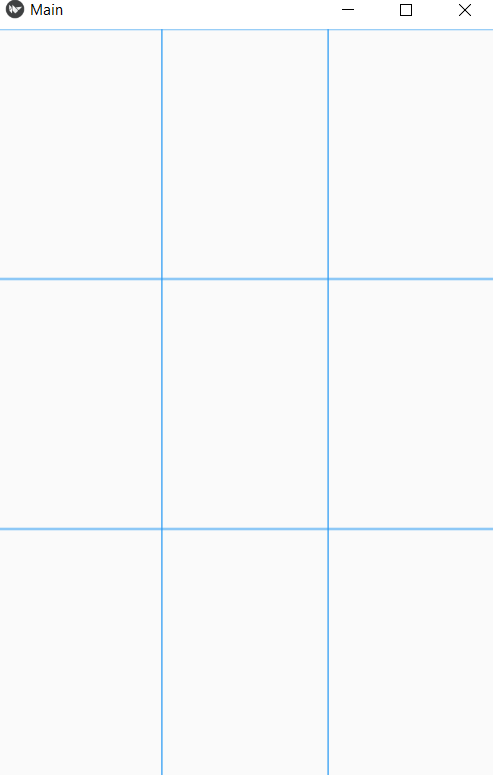
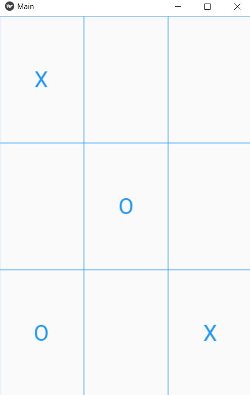
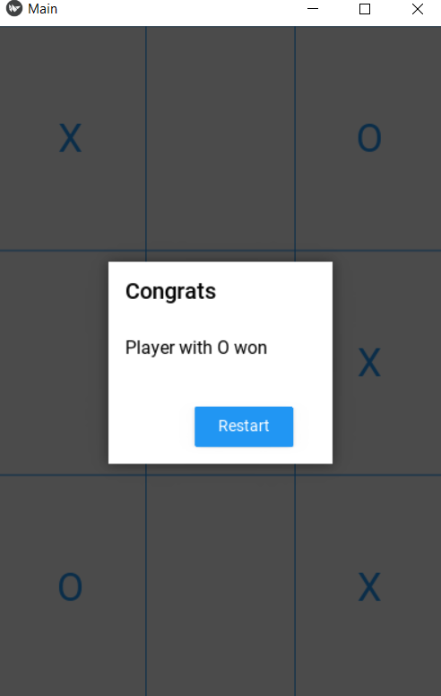

# TicTacToe-App-with-Kivy
A full TicTacToe App developed with Kivy,Python and Kiyvmd with automatic AI moves
powered my MiniMax algorithm

## Features

* 2 Players can play TicTacToe with X and O
* When a Player wins he will be shown a dialog with a congrats message
* When it is Tie, you will be shown a dialog with TIE message
* After players finish playing, they can restart the game 
* Automatic AI moves with MiniMax algo

## Screenshots
 

